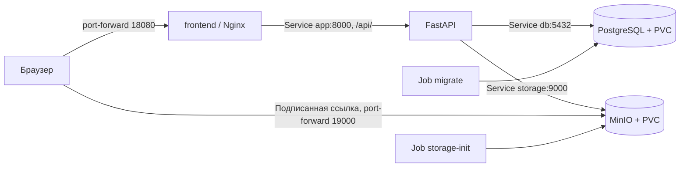

# Locals: самостоятельный Docker, minikube и изучение проекта за 5–9 октября 2026 года

Условия: каждый день 3 часа на работе и 1 час дома, всего 20 часов.
Цель: самостоятельно переписать три Dockerfile и настройки запуска Docker,
выполнить задание на minikube, подготовить архив и скринкаст, разобраться
в архитектуре и основных пользовательских операциях.
Готовое решение планируем получить в четверг вечером; пятница - резерв
и дополнительное изучение. Время блоков - ориентир, а не гарантия скорости.

Это оценка при наличии базового понимания Python и терминала. Изучить весь
проект глубоко за 20 часов не получится. Для этого остаётся отдельный маршрут
в `docs/STUDY_PLAN.md`. На этой неделе изучение идёт вместе с развёртыванием:
каждый новый манифест нужно суметь объяснить своими словами.

Если рабочий и домашний компьютеры разные, кластер вести на одном из них.
Вечерний час использовать для чтения кода, конспекта и отчёта. Развёртывание
двух одинаковых окружений съест время. Работаем с отдельными учебными данными.

## Что уже есть и что предстоит

В репозитории есть Dockerfile для API, frontend и MinIO. Их нужно самостоятельно
переписать, собрать и проверить. Запуск в Compose описан в `compose.yaml` и
`compose.frontend.yaml`. Kubernetes-манифестов на момент составления плана нет.
Все Kubernetes-имена и команды ниже - предложенная схема будущего развёртывания.

Постоянно работают четыре сервиса: FastAPI, frontend/Nginx, PostgreSQL и MinIO.
Отдельные процессы - миграции и создание bucket. Redis и фоновые очереди для
этого задания не нужны. PostgreSQL запускаем из официального образа версии 16.

| Компонент | Планируемые объекты | Что разобраться |
| --- | --- | --- |
| Учебное окружение | Namespace `locals` | Изоляция имён ресурсов |
| API `app` | Deployment + Service | Реплики, labels/selectors, внутренний порт |
| Frontend `frontend` | Deployment + Service | Статика Nginx и проксирование `/api/` |
| PostgreSQL `db` | StatefulSet, Service, PVC | Данные отдельно от жизненного цикла Pod |
| MinIO `storage` | StatefulSet, Service, PVC | Объектное хранилище и сохранение файлов |
| Настройки | ConfigMap + Secret | Обычные параметры и учётные данные |
| Миграции | Job из образа API | `alembic upgrade head` до запуска API |
| Bucket | Job из образа API | `python -m APP.storage_init` |

Для StatefulSet предусмотреть headless Service для идентичности Pod;
подключение клиентов при необходимости вынести в обычный Service.
API и frontend подходят для Deployment; StatefulSet обеспечивает идентичность
и связь с постоянным хранилищем. Сам по себе он не настраивает репликацию БД.
См. [Deployment](https://kubernetes.io/docs/concepts/workloads/controllers/deployment/)
и [StatefulSet](https://kubernetes.io/docs/concepts/workloads/controllers/statefulset/).
Конечные административные операции подходят для
[Job](https://kubernetes.io/docs/concepts/workloads/controllers/job/).

## Как самостоятельно переписывать Docker

Работать в учебной ветке, сохранив текущий рабочий вариант в Git.
Перед каждым файлом составить требования: какой процесс запускаем, какие
файлы и зависимости ему нужны, где конфигурация и данные. Затем написать
свой вариант с пустого файла, собрать, проверить и сравнить с исходным.
У каждого отличия объяснить причину. Проверки идут в отведённое время.

В этой неделе переписываем `Dockerfile`, `frontend/Dockerfile`,
`docker/minio.Dockerfile`, два `.dockerignore`, `compose.yaml` и
`compose.frontend.yaml`. Разбираем `frontend/nginx/default.conf.template`
и восстанавливаем его необходимые маршруты в своей конфигурации.
Python/TypeScript и бизнес-логику целиком переписывать сейчас не требуется.
Версии зависимостей и базовых образов сначала сохранить текущими.

| Файл | Требования к своему варианту | Проверка результата |
| --- | --- | --- |
| `Dockerfile` | Python 3.12, установка requirements, код APP, Alembic и административные скрипты; непривилегированный пользователь; запуск `python -m APP`; метаданные релиза | Входные настройки читаются из env, API отвечает, миграции доступны отдельной командой |
| `frontend/Dockerfile` | Стадия Node с `npm ci` и сборкой, стадия Nginx с готовой статикой и шаблоном настроек | Главная и вложенная страница открываются; `/api/` попадает в backend; `config.json` корректен |
| `docker/minio.Dockerfile` | Сборка выбранного релиза MinIO; runtime с бинарником, сертификатами и пользователем; каталог `/data`; команда сервера | Bucket создаётся; файл загружается и читается; после пересоздания контейнера с тем же volume файл остаётся |
| `.dockerignore` в корне и frontend | Понимать build context каждого образа; исключить секреты, локальные зависимости и артефакты | Нужные исходники попадают в сборку; `.env` и `node_modules` не копируются |
| Оба Compose-файла | Настройки из env, сеть, порты, volumes, healthchecks, отдельные процессы migrate/storage-init | Все четыре сервиса доступны; каталог и аудио работают; данные сохраняются при пересоздании контейнеров |

Для frontend прочитать, как шаблон Nginx обрабатывается при запуске текущего
базового образа. У него уже есть ENTRYPOINT; свой Dockerfile должен учитывать
этот механизм. Для MinIO понять, зачем Python оставлен в текущем runtime:
Compose использует его для healthcheck. Изменение runtime требует обновления
этой проверки. Сборку Go запускать сразу и заниматься остальным, пока она идёт.

Docker изучаем по мере применения: image/container, слои и кэш, build context,
`FROM`, `WORKDIR`, `COPY`, `RUN`, `USER`, `ARG`/`ENV`, `CMD`/`ENTRYPOINT`,
`EXPOSE`, публикация портов, сеть, volumes, multi-stage и остановка процесса.
`RUN` выполняется при сборке; команда контейнера - при запуске. `EXPOSE`
описывает порт и сам не публикует его на компьютере.
[Справочник Dockerfile](https://docs.docker.com/reference/dockerfile/),
[multi-stage](https://docs.docker.com/build/building/multi-stage/),
[порядок слоёв и кэш](https://docs.docker.com/build/building/best-practices/).

## Понедельник, 5 октября - свой образ API и основа Docker

**На работе, 3 часа:**

1. **20 минут:** запустить существующее приложение по README, проверить
   `docker version`; записать четыре сервиса, порты и места хранения данных.
2. **25 минут:** разобрать Docker-понятия и инструкции, нужные для API.
   Объяснить build context, image/container, ARG/ENV, RUN/CMD, слой и кэш.
3. **60 минут:** самостоятельно написать корневой Dockerfile и `.dockerignore`.
   Сначала составить требования, затем написать, собрать и сравнить с текущим.
   Прочитать `APP/__main__.py`: от него зависит команда запуска контейнера.
4. **30 минут:** запустить свой образ с учебными настройками и доступной ему
   PostgreSQL, проверить health endpoints, логи и остановку. Изменить только
   исходник, повторить сборку, увидеть, кэшируется ли установка зависимостей.
5. **45 минут:** проверить kubectl, установить minikube при необходимости,
   запустить профиль `locals-lab`, проверить `kubectl get nodes`.

**Дома, 1 час:** **15 минут** на `APP/main.py`, настройки и закрытие соединений;
**45 минут** на модели User/Artist/Track, схемы и `alembic/env.py`.
Разобрать, кто описывает хранение, API-контракт и изменения таблиц.
В `scripts/check_migrations.py` найти отличие проверки миграций от их применения.

**Результат дня:** свой образ API собирается и работает; minikube запущен;
можешь объяснить запуск Python, основные инструкции Docker и назначение миграций.

Инструкции установки выбирать под свою ОС:
[Docker](https://docs.docker.com/engine/install/),
[minikube](https://minikube.sigs.k8s.io/docs/start/).
Если Docker Desktop уже работает, сначала проверить его, а не устанавливать
ещё один Docker Engine.

## Вторник, 6 октября - свои frontend, MinIO и Compose

**На работе, 3 часа:**

1. **60 минут:** самостоятельно переписать frontend/Dockerfile и его
   `.dockerignore`; разобрать и восстановить необходимые маршруты Nginx.
   Проверить multi-stage, сборку React, открытие вложенной страницы и `/api/`.
2. **45 минут:** самостоятельно переписать MinIO Dockerfile, запустить сборку.
   Разобрать стадии, сертификаты, `/data`, права пользователя, ENTRYPOINT/CMD.
   Проверить сервер и сохранение файла с постоянным volume, когда сборка готова.
3. **45 минут:** переписать Compose и frontend override по требованиям текущего
   приложения. Подключить свои образы, env, сеть, порты, volumes и проверки.
   Выполнить миграции и storage-init отдельными процессами; проверить UI и аудио.
4. **30 минут:** выполнить основные упражнения kubectl на архиве семинара:
   `apply`, `get`, `describe`, `logs`, `exec`, `scale`, `delete`.
   Архив семинара не входит в репозиторий; использовать приложенные преподавателем
   примеры до развёртывания своего приложения, как требует задание.

**Дома, 1 час:** пройти регистрацию/вход: `AuthProvider.tsx` →
`frontend/src/api/client.ts` → `APP/API/v1/auth.py` → `APP/services/auth.py`.
Объяснить access, refresh-cookie, сессию в БД, logout и проверку прав.
Посмотреть один реальный запрос через DevTools. Внести схему сервисов в отчёт.

**Результат дня:** три своих Dockerfile и свой запуск Compose работают;
понимаешь контейнеры, сеть, тома и путь входа пользователя.
Сборка MinIO может занять больше отведённого блока; её завершение отслеживать
параллельно. Загрузка образов в minikube - первый блок среды.

Для требования задания `docker-env` используем Docker runtime явно:

```bash
minikube start -p locals-lab --driver=docker --container-runtime=docker
eval "$(minikube -p locals-lab docker-env)"

docker build -t locals-api:lab .
docker build -t locals-web:lab frontend
docker build -f docker/minio.Dockerfile -t locals-minio:lab .
```

Сборка через этот daemon уже помещает образы в кластер; отдельная загрузка
обычно не нужна. Поскольку в задании также указан `image load`, выполнить его
явно через сохранённый архив, без повторной сборки:

```bash
docker save -o /tmp/locals-lab-images.tar locals-api:lab locals-web:lab locals-minio:lab
eval "$(minikube -p locals-lab docker-env -u)"
minikube -p locals-lab image load /tmp/locals-lab-images.tar
minikube -p locals-lab image ls
```

Переключение daemon действует только в текущем терминале. Для собственных
локальных образов задать `imagePullPolicy: IfNotPresent` и конкретный тег.
Основание: [способы загрузки образов](https://minikube.sigs.k8s.io/docs/handbook/pushing/)
и [команда image load](https://minikube.sigs.k8s.io/docs/commands/image/#minikube-image-load).

## Среда, 7 октября - перенос своего запуска в Kubernetes

**На работе, 3 часа:**

1. **20 минут активной работы:** использовать `docker-env`, начать сборку
   и подготовить загрузку своих образов в minikube по командам выше.
   Проверить теги и imagePullPolicy. Пока идёт длительная сборка, писать
   манифесты в другом терминале; готовность образов проверить до запуска Jobs/API.
   Кэши Docker на компьютере и daemon minikube могут различаться: не рассчитывать,
   что вчерашняя сборка автоматически ускорит сегодняшнюю. Ожидание может быть
   дольше этого блока. Этот этап предполагает проверенные Dockerfile во вторник.
2. **40 минут:** написать Namespace, ConfigMap, шаблон Secret и Services.
   Сопоставить Docker Compose с объектами Kubernetes: сеть, env, зависимости.
3. **60 минут:** написать и запустить PostgreSQL/MinIO StatefulSet с PVC,
   проверить готовность, логи и права записи. Объяснить labels/selectors и DNS.
4. **25 минут:** создать Jobs миграций и bucket, дождаться Complete.
5. **35 минут:** добавить Deployment/Service API и frontend, ресурсы и probes,
   открыть UI через port-forward. Для API использовать health/live и health/ready.
   Ready проверяет подключение к БД, но не проверяет миграции и MinIO.

Порядок применения: зависимости Ready → Jobs Complete → API и frontend.
На этой неделе манифесты можно готовить с помощью ИИ по условиям задания,
а каждое поле и результат применения разбирать самостоятельно. Все Dockerfile
при этом пишешь ты. Если и весь YAML пишешь впервые без подсказок, на среду
может потребоваться больше времени: используем резерв, не пропускаем проверки.

**Дома, 1 час:** пройти один запрос оценки:
`frontend/src/features/ratings/RatingControl.tsx` → `frontend/src/api/client.ts`
→ Nginx → `APP/API/v1/rating.py` → `APP/services/ratings.py` → PostgreSQL.
В DevTools увидеть запрос и ответ. Найти проверку пользователя, транзакцию
и обновление агрегатов; записать последовательность своими словами.

**Результат дня:** сайт и API доступны в minikube, база мигрирована, bucket создан.
Проверка всех пользовательских сценариев и подготовка демоданных - утром четверга.
Понимаешь, как твои образы используются Kubernetes, и путь оценки до PostgreSQL.

Простой доступ для учебного запуска - два port-forward в отдельных терминалах:

```bash
kubectl --context=locals-lab -n locals port-forward service/frontend 18080:8080
kubectl --context=locals-lab -n locals port-forward service/storage 19000:9000
```

Открывать `http://127.0.0.1:18080`. Использовать эти же адреса в настройках:

- frontend: `API_UPSTREAM=http://app:8000`;
- API: `S3_ENDPOINT_URL=http://storage:9000`;
- API: `S3_PUBLIC_ENDPOINT_URL=http://127.0.0.1:19000`;
- API: `BROWSER_ALLOWED_ORIGINS=["http://127.0.0.1:18080"]`;
- для учебного HTTP: `BROWSER_COOKIE_SECURE=false`;
- разрешённый origin MinIO/bucket: `http://127.0.0.1:18080`.

Адрес `storage` доступен внутри кластера, но не браузеру. Публичный endpoint
нужен для подписанных ссылок на аудио. Порты 18080/19000 позволяют отличить
учебный сайт от уже запущенного Compose. Port-forward выбирает один Pod;
при его замене команду может потребоваться запустить заново. Это способ доступа,
а не демонстрация балансировки между репликами.
[Документация port-forward](https://kubernetes.io/docs/tasks/access-application-cluster/port-forward-access-application-cluster/).

В открытом сейчас `scripts/check_migrations.py` находится проверка миграций
на отдельной тестовой схеме: upgrade, check, downgrade и повторный upgrade.
Для развёртывания нужен Job с `alembic upgrade head`.

## Четверг, 8 октября - пользовательские сценарии, масштабирование и запись

**На работе, 3 часа:**

1. **50 минут:** создать учебного админа существующей CLI-командой,
   добавить артиста, трек, небольшое аудио; проверить вход, каталог, оценку,
   лайк, Liked, карту. Смотреть Network, находить связанные роутеры/сервисы.
2. **40 минут:** увеличить API и frontend с одной до двух реплик, дождаться
   Ready. Проверить работу и замену Pod с сохранением данных PostgreSQL/MinIO.
   PVC и namespace сохранять. Разобрать ошибки через describe/logs.
3. **40 минут:** подготовить повторяемый запуск для видео и выполнить репетицию.
   Заранее собрать образы и подготовить данные. Если нужно повторно запускать
   завершённые Jobs, предусмотреть их пересоздание. Не расходовать запись
   на сборку образов или долгую загрузку зависимостей.
4. **50 минут:** записать демонстрацию до 7 минут, просмотреть её,
   собрать предварительный архив. Убедиться, что команды и UI читаемы.

**Дома, 1 час:** **30 минут** пройти получение аудио через
`APP/services/media.py`, `APP/core/storage.py` и `PlayerProvider.tsx`;
**30 минут** завершить отчёт, инструкцию и архив. Черновик отчёта заполнять
короткими заметками каждый день, чтобы этого времени хватило.
Результат уже должен быть пригоден для сдачи независимо от пятницы.

**Результат дня:** готовые манифесты, отчёт, скринкаст и архив.

Масштабирование для предложенных имён Deployment:

```bash
kubectl --context=locals-lab -n locals scale deployment/app deployment/frontend --replicas=2
kubectl --context=locals-lab -n locals rollout status deployment/app
kubectl --context=locals-lab -n locals rollout status deployment/frontend
kubectl --context=locals-lab -n locals get pods
```

PostgreSQL и MinIO оставить с одной репликой. Добавление реплик требует отдельной
архитектуры хранения. У всех API-реплик должен быть одинаковый JWT secret,
общая БД и общее хранилище. PVC сохраняет данные при замене Pod, но удаление
всего профиля minikube может удалить и учебные данные.

## Пятница, 9 октября - резерв и закрепление

**На работе, 3 часа:**

1. **30 минут:** проверить запуск строго по инструкции из архива;
   сверить обязательные действия с критериями задания.
2. **60 минут:** исправить проблемы и при необходимости перезаписать видео.
3. **60 минут:** если всё готово, разобрать библиотеку и карту:
   `APP/services/library.py`, `APP/services/places.py`,
   `frontend/src/features/events/MapPage.tsx`, `SceneEditorPage.tsx`.
   Найти источник Liked, связь события с площадкой и запросы при изменении карты.
   При проблемах этот час использовать как резерв.
4. **30 минут:** устно объяснить проект по схеме без подсказок; проверить
   наличие исходников манифестов и четырёх обязательных действий на видео.

**Дома, 1 час:** **20 минут** проверить архив, видео и сдачу;
**40 минут**, если всё готово, обзор XP, предложений и рекомендаций:
`APP/services/experience.py`, `gamification.py`, `contributions.py`,
`recommendations.py`. Найти триггеры начисления, принятия предложений и
ранжирования. Глубокое изучение этих алгоритмов продолжить после дедлайна.
Если сдача требуется утром пятницы, отправить готовое решение в четверг.

## Что положить в архив

- Все использованные Dockerfile, Kubernetes-манифесты, скрипты запуска.
- Исходники и файлы зависимостей, необходимые для сборки; исключить `.git`,
  `.venv`, `node_modules`, реальные `.env` и локальные данные БД/MinIO.
- Шаблон настроек и способ создания учебного Secret с собственными значениями.
- `Отчёт.md` с перечнем абстракций и схемой взаимодействия сервисов.
- Инструкцию повторения: сборка/загрузка образов, создание настроек,
  поэтапный apply, ожидание Jobs, доступ к сайту, scale.
- `скринкаст.mp4` длительностью не более 7 минут.

В отчёте объяснить: Namespace, Deployment, StatefulSet, Pod, Service,
ConfigMap, Secret, PVC, Job; readiness/liveness; куда идут запросы и где
хранятся данные. Отдельно указать одноузловой учебный характер запуска.



## Сценарий скринкаста на 6–6,5 минуты

| Время | Что показать |
| --- | --- |
| 0:00–0:30 | Название проекта, текущий context, единственный узел |
| 0:30–2:00 | `kubectl apply` зависимостей, Jobs и приложения; ожидание готовности |
| 2:00–2:45 | `kubectl get pods`, Services, PVC; Jobs в Complete |
| 2:45–3:45 | `kubectl scale`, ожидание двух Ready-реплик API и frontend, повторный get pods |
| 3:45–5:45 | Войти в UI, открыть каталог, запустить аудио, поставить оценку, открыть карту |
| 5:45–6:30 | Коротко объяснить взаимодействие компонентов и сохранение данных |

На репетиции проверить, что запуск укладывается в отведённое время.
Вывод `Completed` у Pod конечного Job - нормальный результат.

## Как понять максимум проекта в этих 20 часах

| Поток | Когда | Что нужно объяснить |
| --- | --- | --- |
| Запуск и конфигурация | Понедельник | Python/Uvicorn, lifespan, env, подключения и остановка |
| Хранение и миграции | Понедельник дома | ORM-модель, схема ответа, FK/M2M, Alembic |
| Frontend и инфраструктура | Вторник | Node build, Nginx, proxy, сети, порты, volumes |
| Авторизация и права | Вторник дома | Access/refresh, сессия в БД, logout, owner/level |
| Каталог и оценки | Среда дома / четверг | Роутер, Depends, сервис, SQL, транзакция и агрегаты |
| Медиа и плеер | Четверг | Загрузка, ключ в БД, объект MinIO, временная ссылка |
| Библиотека и карта | Пятница при готовом задании | Favorite/Liked, порядок плейлиста, event/venue, координаты |
| XP, предложения, рекомендации | Пятница дома при готовом задании | Основные сущности, триггеры и точки входа |

Для каждого потока прочитать один настоящий пример запроса и понять его
результат. В React отдельно отмечать: компонент, состояние, вызов API,
получение данных через TanStack Query и обновление UI. Все файлы читать
подряд за эту неделю не успеем; покрываем устройство каждой крупной подсистемы.

После успешной сдачи вернуться к `docs/STUDY_PLAN.md` для деталей транзакций,
конкурентных запросов, тестирования и изменения бизнес-правил.

В каждом часовом блоке последние 5–10 минут отводить на объяснение:
что сделал, какой объект или файл это обеспечивает, чем проверил результат.
Это время уже входит в расписание. Если команда не работает, читать
`describe`/`logs` и фиксировать причину; не перебирать команды вслепую.

К сдаче уметь ответить без чтения кода:

1. Что находится в каждом самостоятельно написанном образе и какой процесс запускается?
2. Как запрос из браузера попадает в FastAPI?
3. Почему Service остаётся доступным при замене Pod?
4. Где хранятся пользователи, оценки и аудио?
5. Зачем миграциям отдельный Job и почему probes недостаточно?
6. Почему можно масштабировать API/frontend и нельзя так же размножить PostgreSQL?
7. Чем внутренний адрес MinIO отличается от URL для браузера?
8. Как по событию Pod или логам найти причину ошибки запуска?
9. Как работает кэш сборки и зачем frontend/MinIO используют несколько стадий?
10. Как подтверждена работоспособность каждого переписанного Docker-файла?

Если отстаём: сначала полный запуск, четыре действия скринкаста и архив.
Обзор дополнительных подсистем в пятницу можно заменить устранением проблем.
Если переписывание Docker занимает больше двух дней, сразу использовать резерв
пятницы и перенести дополнительные чтения. Исходный рабочий вариант использовать
для поиска различий и причин ошибок, сохраняя свою работу в учебной ветке.
Глубокий разбор алгоритмов, CI и всех frontend-компонентов продолжить после сдачи.
