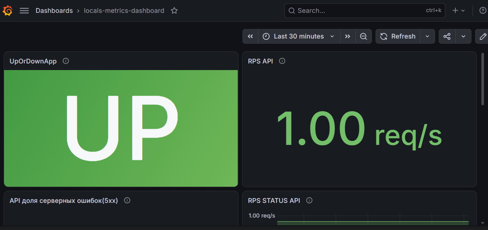
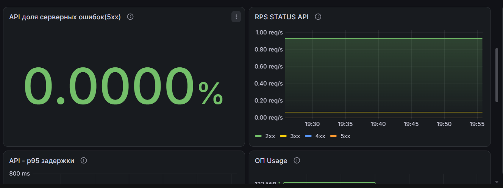
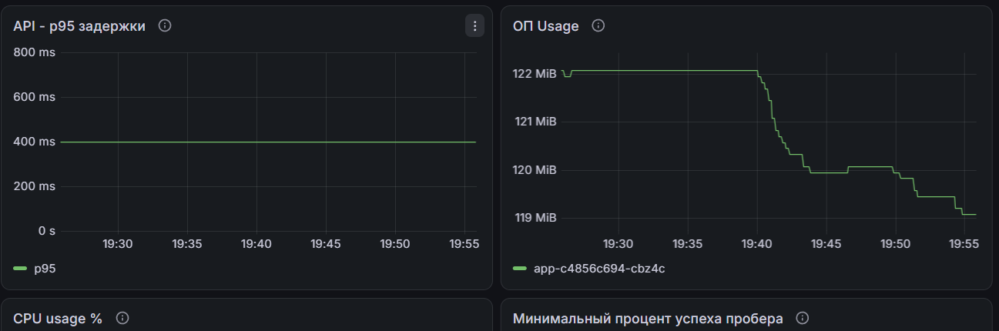
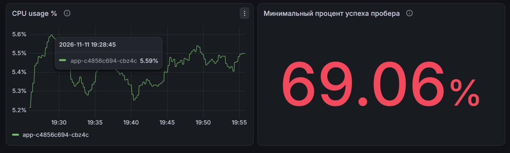

# Grafana Locals

Метрики из VictoriaMetrics.
UP показывает работает ли сбор метрик с backend. RPS - средняя скорость HTTP запросов за 5 минут без health проверок.

RED: интенсивность запросов, доля ошибок 5xx и p95 задержки.

Использование памяти и цпу одного ядра конкретным pod-ом

prober - SLA проверка за 30 дней, 99% у нас, но я там специально ложил сервис для проверок на прошлой дз

Импортирован PostgreSQL FULL monitoring dashboard (ID 25393).

Экспорт дашборда : [locals-metrics-dashboard.json](locals-metrics-dashboard.json).
Запустить приложение можно через [README](k8s/logging/README-victoria.md)