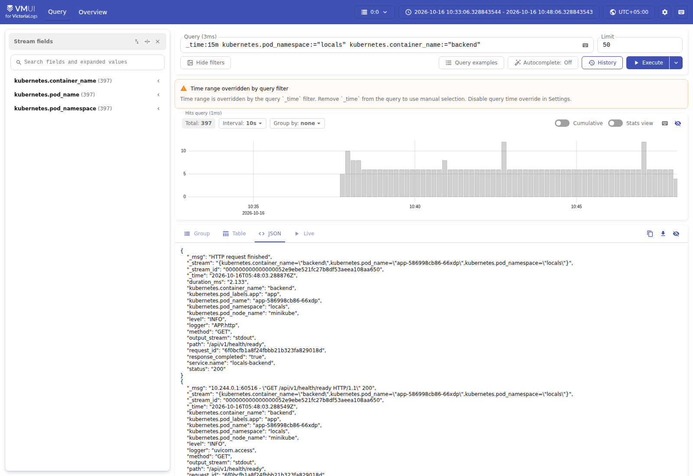
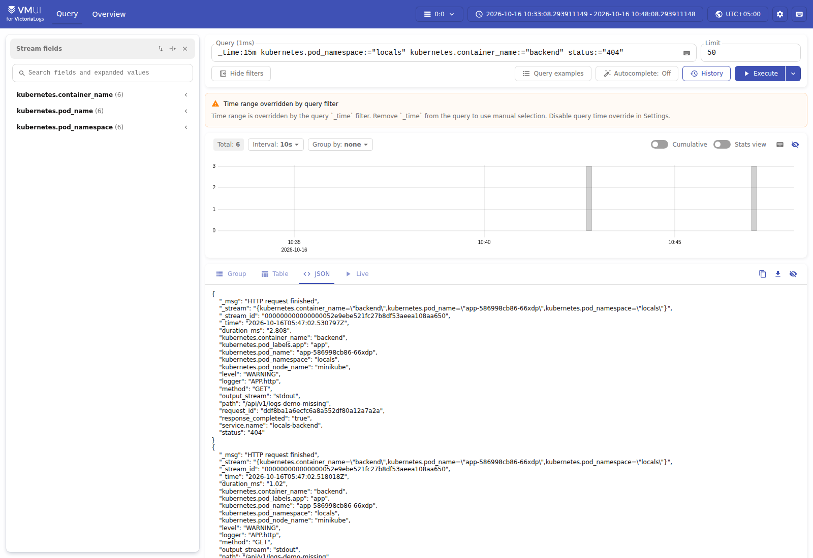
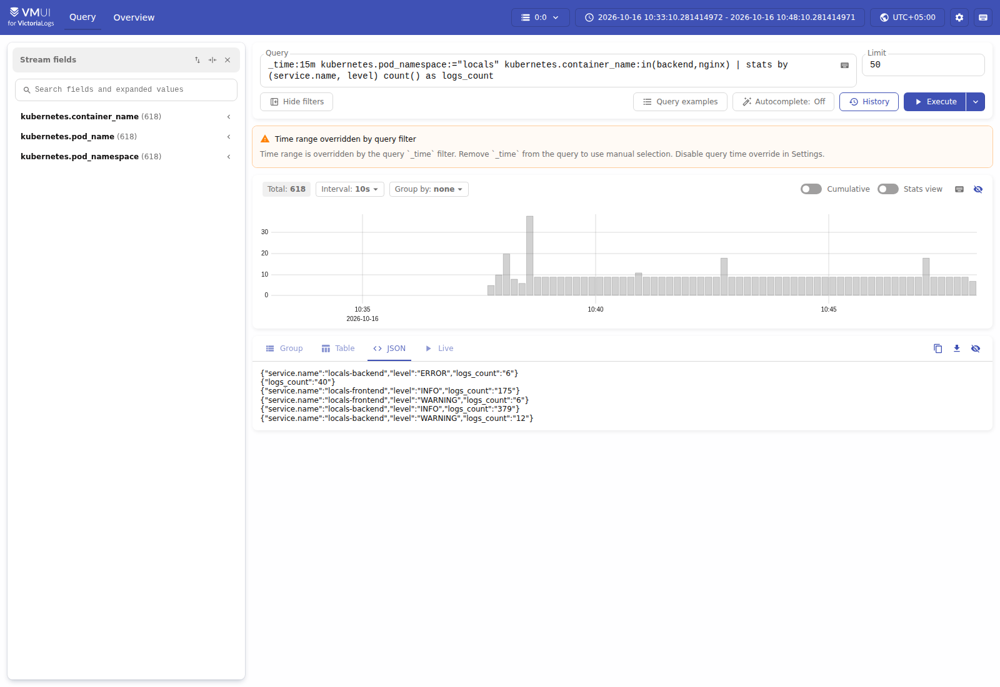
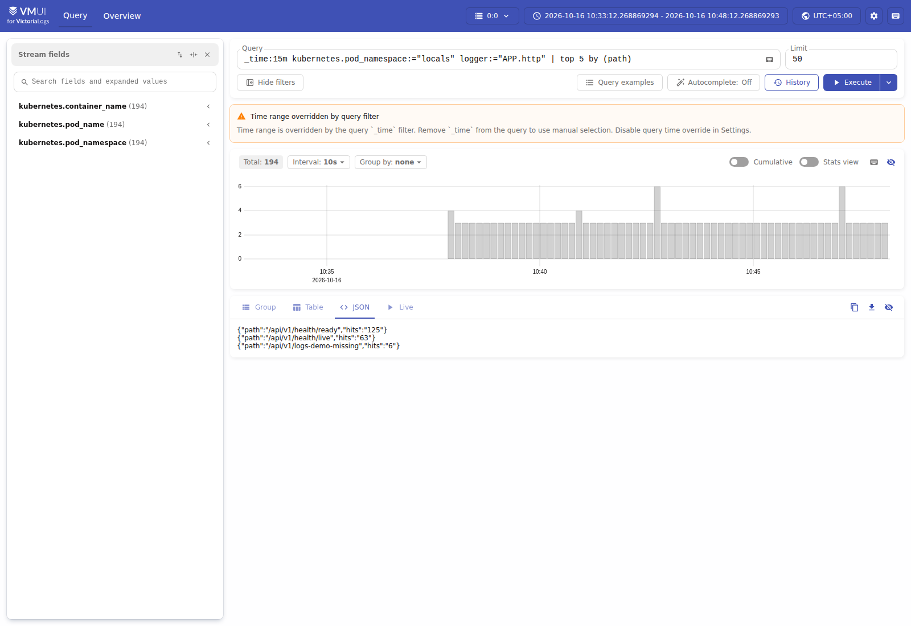
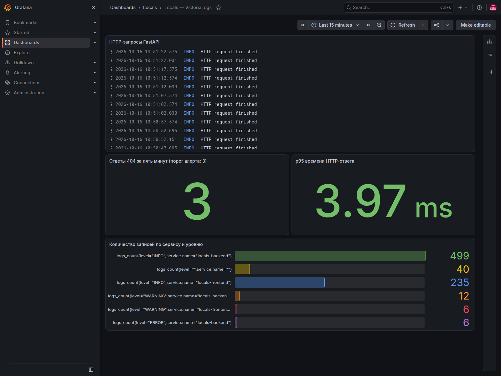
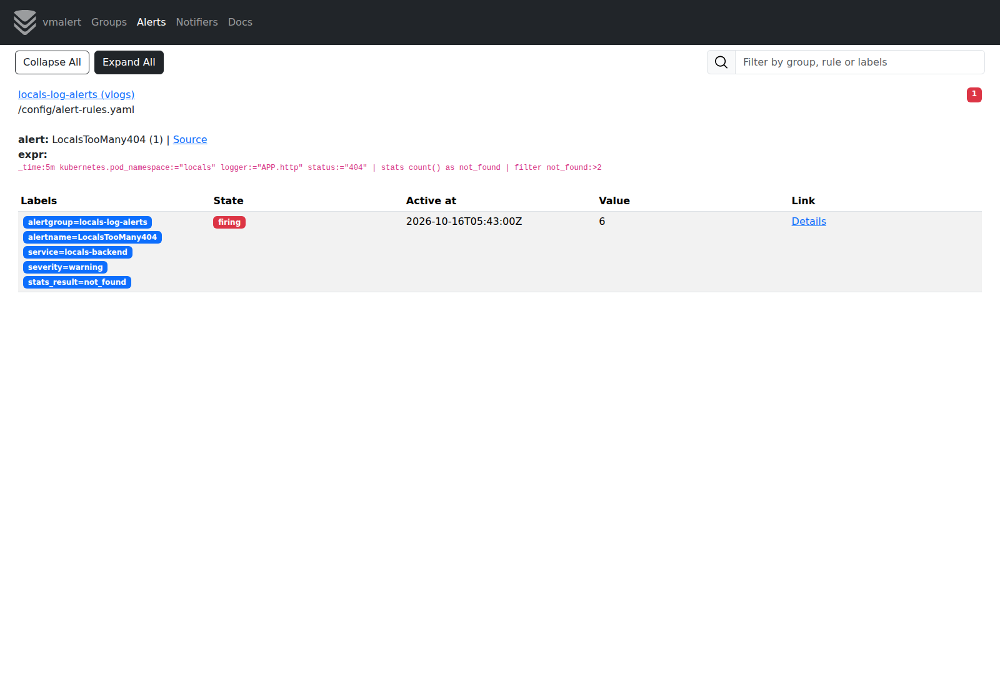
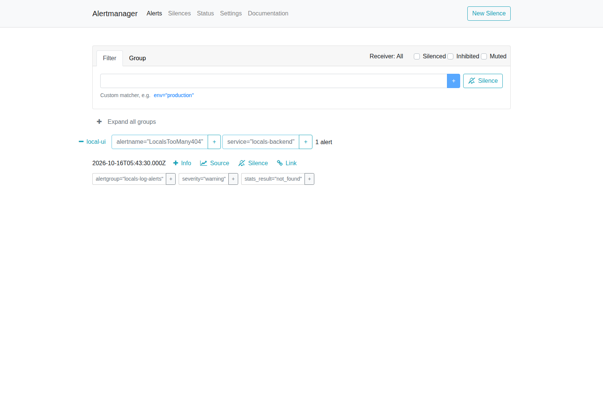

## Что сделано

Я сделал логирование через single node victoria-logs , collector тоже от victoria-logs, аллертирование vmalert с Менеджером куда приходит Алёрт, интегрировал модуль grafana и всё в одном кластере с моим Locals. Настроил выдачу json с backend-а и frontend - а Выбран официальный collector развёрнутый как DaemonSet. Он читает логи контейнеров на узле, разбирает JSON, добавляет метаданные Pod и отправляет записи в VictoriaLogs.

### 1. Сырые записи за последне 15 минут

Команда:
```text
_time:15m kubernetes.pod_namespace:="locals" kubernetes.container_name:="backend"
```



### 2. Фильтрация по конкретному полю

Команда Фильтр по статусу:
```text
_time:15m kubernetes.pod_namespace:="locals" kubernetes.container_name:="backend" status:="404"
```



### 3. Stats с группировкой

```text
_time:15m kubernetes.pod_namespace:="locals" kubernetes.container_name:in(backend,nginx)
| stats by (service.name, level) count() as logs_count
```



### 4. Top

Топ пять по популярности путей:

```text
_time:15m kubernetes.pod_namespace:="locals" logger:="APP.http"
| top 5 by (path)
```



## Grafana плагин



## vmalert

На основе фильтра 404 из запроса №2 добавлена агрегация и порог:

```text
_time:5m kubernetes.pod_namespace:="locals" logger:="APP.http" status:="404"
| stats count() as not_found
| filter not_found:>2
```





