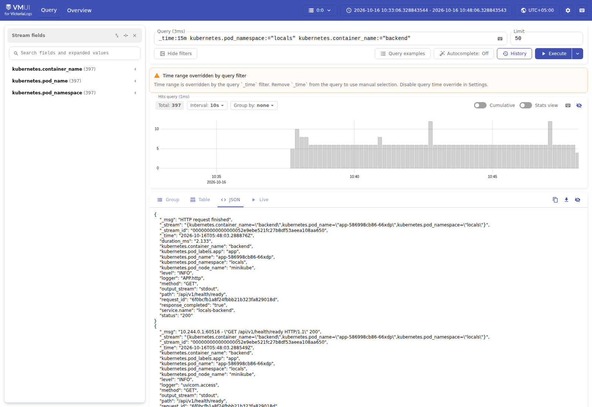
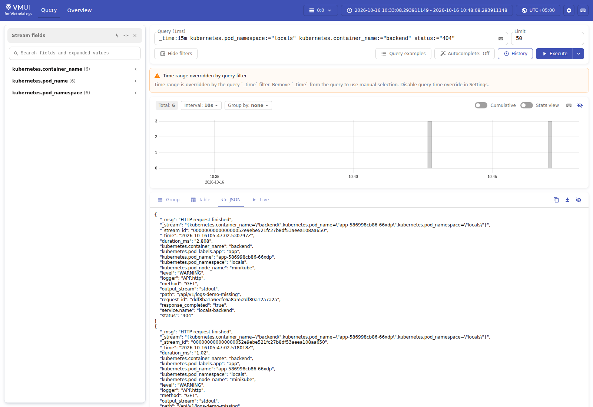
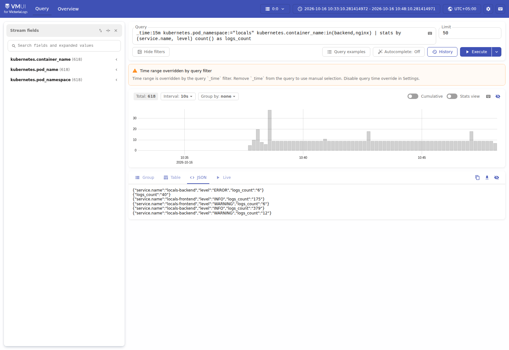
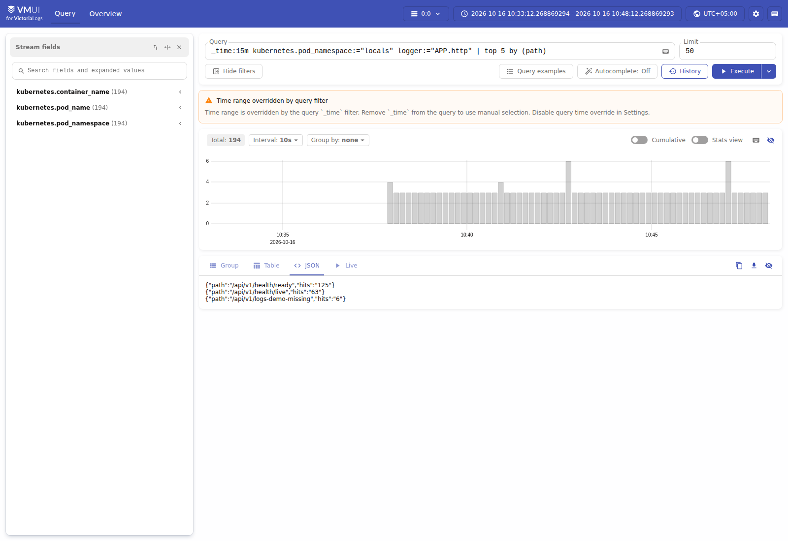
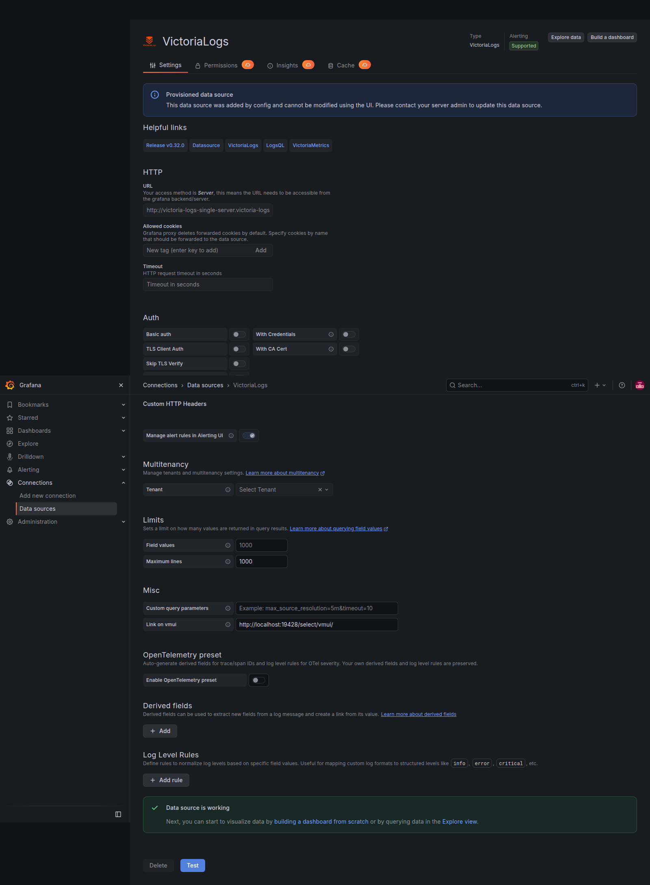
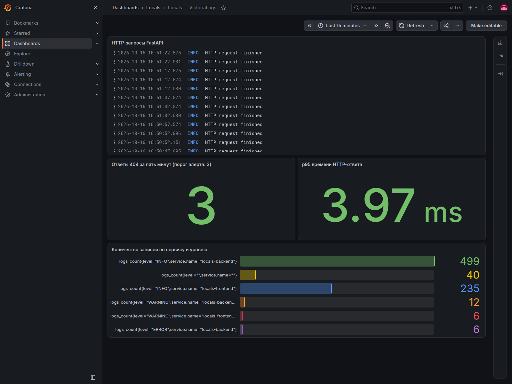
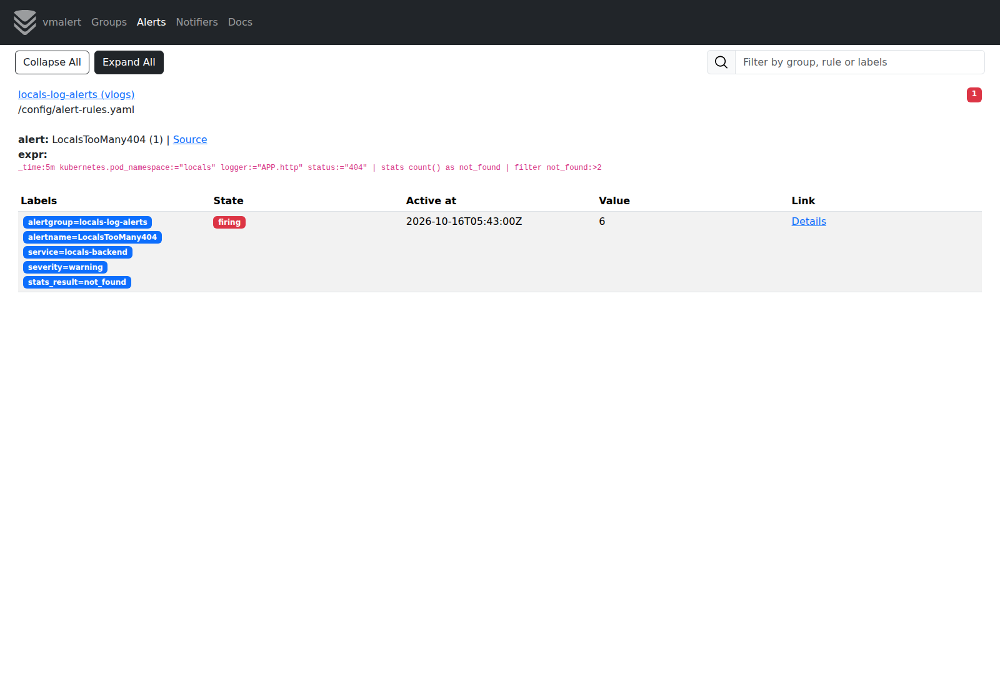
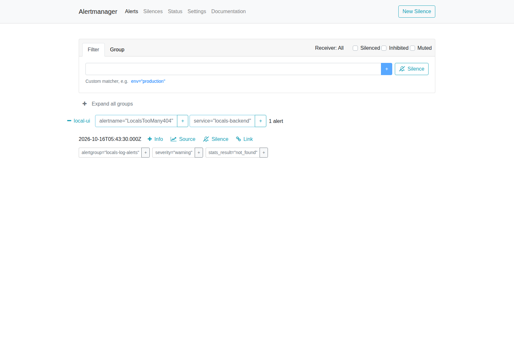

## Что сделано

Я сделал логирование через single node victoria-logs , collector тоже от victoria-logs, аллертирование vmalert с Менеджером куда приходит Алёрт, интегрировал модуль grafana и всё в одном кластере с моим Locals. 
Настроил выдачу json с backend-а и frontend - а
Выбран официальный collector развёрнутый как DaemonSet.
Он читает логи контейнеров на узле, разбирает JSON, добавляет метаданные Pod
и отправляет записи в VictoriaLogs.


### 1. Сырые записи за последне 15 минут

Команда:
```text
_time:15m kubernetes.pod_namespace:="locals" kubernetes.container_name:="backend"
```



### 2. Фильтрация по конкретному полю

Команда Фильтр по статусу:
```text
_time:15m kubernetes.pod_namespace:="locals" kubernetes.container_name:="backend" status:="404"
```



### 3. Stats с группировкой

```text
_time:15m kubernetes.pod_namespace:="locals" kubernetes.container_name:in(backend,nginx)
| stats by (service.name, level) count() as logs_count
```

Показывает число записей по сервису и уровню. Один пользовательский запрос
может дать записи и Nginx, и FastAPI; это не число уникальных запросов.
Служебные текстовые сообщения при запуске Nginx могут попасть в строку без
`service.name` и `level`; JSON access-записи имеют эти поля.
//УДАЛИТЬ


### 4. Top

Топ пять по популярности путей:

```text
_time:15m kubernetes.pod_namespace:="locals" logger:="APP.http"
| top 5 by (path)
```



## Бонус 1: официальный Grafana-плагин VictoriaLogs

Grafana развёрнута в том же Minikube через Helm. Плагин
`victoriametrics-logs-datasource` версии `0.32.0` устанавливается автоматически.
Datasource `VictoriaLogs` создаётся через provisioning и обращается к
внутреннему Service VictoriaLogs. Пароль администратора генерируется chart
и хранится в Kubernetes Secret; в отчёт и values не включён.

Проверка datasource вернула **Data source is working**. Запросы всех четырёх
панелей dashboard проверены через Grafana datasource API без ошибок.



Dashboard **Locals — VictoriaLogs** загружается из ConfigMap. Он показывает
HTTP-логи, число 404 за пять минут, p95 длительности ответа в миллисекундах
и распределение записей по сервисам и уровням.



## Бонус 2: алерт через vmalert

На основе фильтра 404 из запроса №2 добавлена агрегация и порог:

```text
_time:5m kubernetes.pod_namespace:="locals" logger:="APP.http" status:="404"
| stats count() as not_found
| filter not_found:>2
```

Группа правил имеет тип `vlogs`. Правило **LocalsTooMany404** оценивается
каждые 15 секунд; для срабатывания условие должно выполняться 30 секунд.
Берутся только записи `APP.http`, поэтому один запрос не учитывается
повторно из-за access-лога Nginx или Uvicorn.

Проверена цепочка: три реальных HTTP-запроса к отсутствующему API-маршруту
вернули 404 → записи поступили через collector → LogsQL вернул
`not_found=3` → правило перешло из Inactive в Firing → Alertmanager принял
алерт как Active. На скриншоте значение может быть выше трёх, поскольку
для повторной демонстрации выполнялись дополнительные запросы.





Alertmanager использует локальный receiver без внешних отправок.
Состояние vmalert не записывается в отдельную VictoriaMetrics: recording
rules отсутствуют, после перезапуска таймер `for` начинается заново.
После выхода ответов 404 из пятиминутного окна условие перестаёт выполняться.
Автоматическое снятие также проверено: после завершения демонстрации
vmalert вернулся в `inactive`, состояние правила осталось `health=ok`.
Это учебный алерт; в рабочей среде стоит отдельно контролировать 5xx и задержки.

## Проверки перед сдачей

- [x] VictoriaLogs Ready, PVC Bound; collector Ready.
- [x] В работающем приложении есть новое JSON-логирование.
- [x] Новая JSON-запись приложения найдена в VictoriaLogs.
- [x] Все четыре запроса выполнены в vmui и возвращают ожидаемые результаты.
- [x] Четыре изображения добавлены в отчёт ссылками на реальные файлы.
- [x] Grafana datasource работает; dashboard отображает реальные данные.
- [x] vmalert перешёл в Firing; Alertmanager получил алерт.
- [x] После выхода тестовых записей из окна vmalert вернулся в Inactive.
- [x] Values, README, скрипт установки и восемь скриншотов подготовлены.
- [ ] Отправить архив или ссылку на коммит/ветку с этими материалами.

Все результаты относятся к проверке 16.10.2026. После длительной паузы
для повторной демонстрации нужны свежие запросы: временные окна ограничены.
